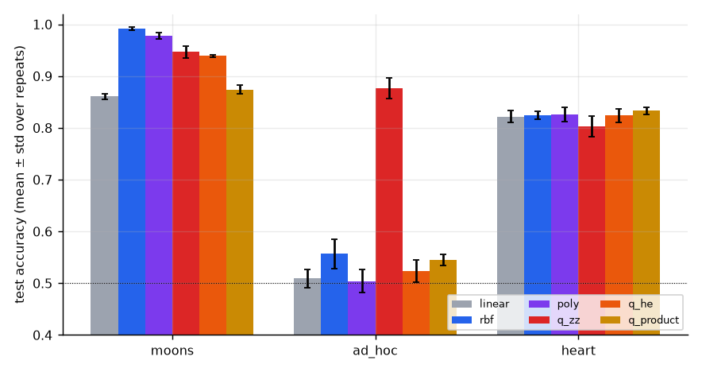
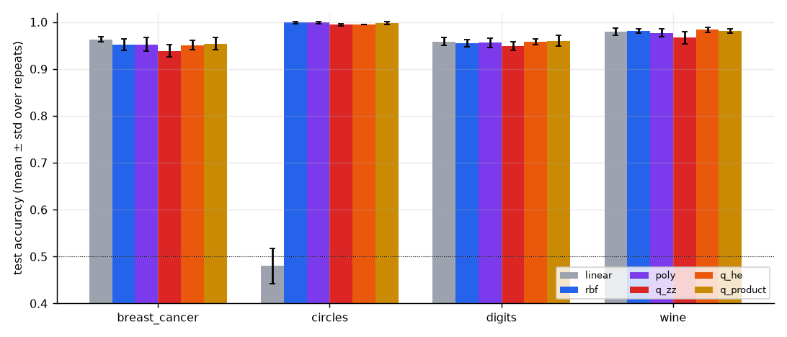
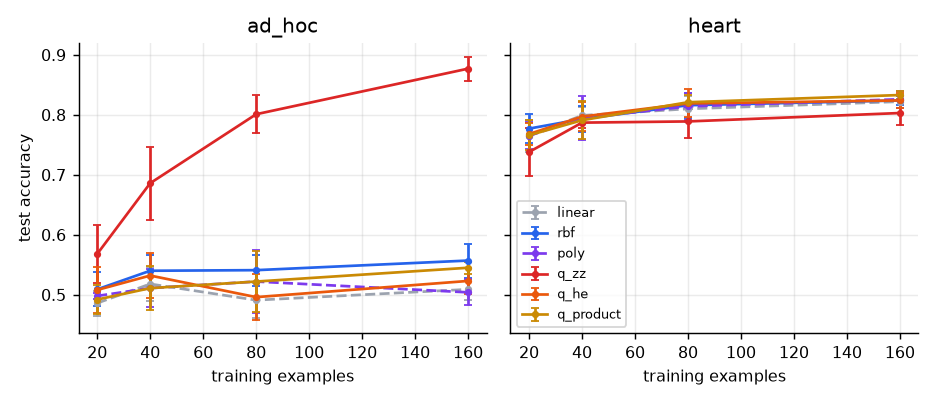
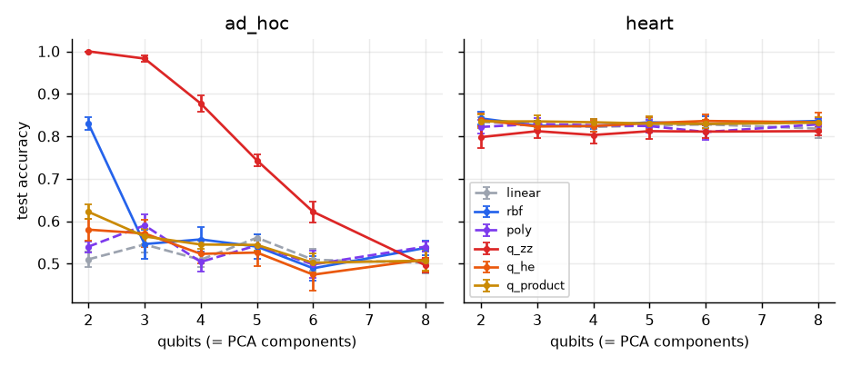
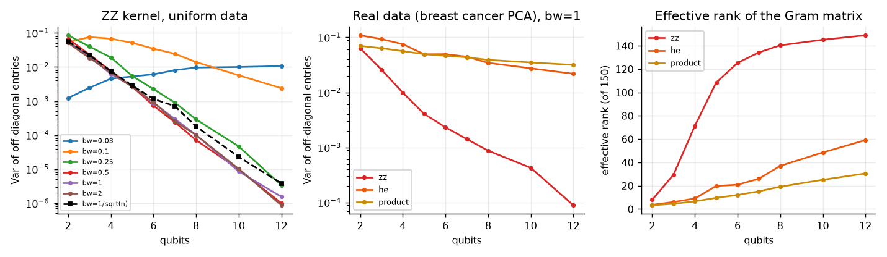
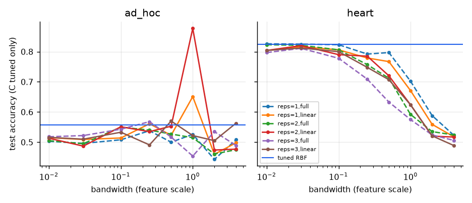
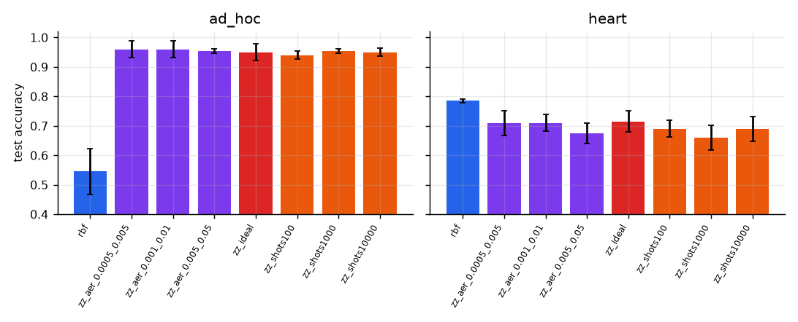
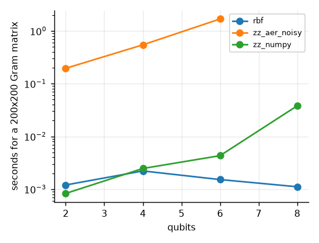
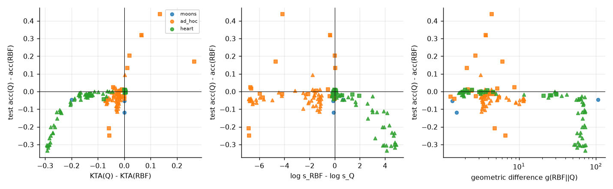
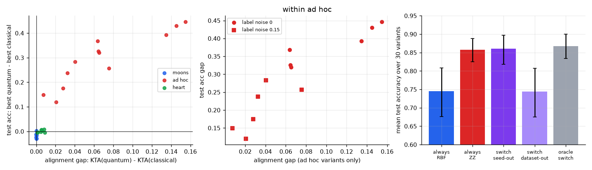

# Results report (full run)

## Main comparison (4 qubits)

| dataset | model | acc | f1 | auc | acc_std | auc_std | n_folds |
|---|---|---|---|---|---|---|---|
| ad_hoc | linear | 0.509 | 0.518 | 0.505 | 0.018 | 0.015 | 25 |
| ad_hoc | poly | 0.504 | 0.516 | 0.509 | 0.022 | 0.018 | 25 |
| ad_hoc | q_he | 0.523 | 0.513 | 0.563 | 0.022 | 0.034 | 25 |
| ad_hoc | q_product | 0.545 | 0.555 | 0.561 | 0.010 | 0.010 | 25 |
| ad_hoc | q_zz | 0.877 | 0.873 | 0.954 | 0.020 | 0.008 | 25 |
| ad_hoc | rbf | 0.557 | 0.526 | 0.572 | 0.028 | 0.032 | 25 |
| heart | linear | 0.822 | 0.824 | 0.893 | 0.011 | 0.002 | 25 |
| heart | poly | 0.826 | 0.829 | 0.894 | 0.014 | 0.005 | 25 |
| heart | q_he | 0.824 | 0.825 | 0.895 | 0.013 | 0.005 | 25 |
| heart | q_product | 0.833 | 0.835 | 0.896 | 0.007 | 0.002 | 25 |
| heart | q_zz | 0.803 | 0.804 | 0.873 | 0.020 | 0.019 | 25 |
| heart | rbf | 0.824 | 0.826 | 0.891 | 0.007 | 0.004 | 25 |
| moons | linear | 0.861 | 0.864 | 0.951 | 0.005 | 0.004 | 25 |
| moons | poly | 0.978 | 0.978 | 0.989 | 0.007 | 0.005 | 25 |
| moons | q_he | 0.939 | 0.939 | 0.973 | 0.002 | 0.004 | 25 |
| moons | q_product | 0.874 | 0.875 | 0.930 | 0.008 | 0.010 | 25 |
| moons | q_zz | 0.947 | 0.947 | 0.988 | 0.012 | 0.005 | 25 |
| moons | rbf | 0.992 | 0.992 | 0.996 | 0.003 | 0.002 | 25 |

Corrected resampled t-tests (Nadeau-Bengio), Holm-adjusted across all rows:

| dataset | quantum | vs | mean_diff | t | p_raw | p_holm |
|---|---|---|---|---|---|---|
| ad_hoc | q_he | rbf | -0.034 | -0.838 | 0.410 | 1.000 |
| ad_hoc | q_product | rbf | -0.012 | -0.259 | 0.798 | 1.000 |
| ad_hoc | q_zz | rbf | 0.320 | 5.501 | 0.000 | 0.000 |
| heart | q_he | rbf | -0.000 | -0.000 | 1.000 | 1.000 |
| heart | q_he | poly | -0.002 | -0.115 | 0.909 | 1.000 |
| heart | q_product | rbf | 0.009 | 0.737 | 0.468 | 1.000 |
| heart | q_product | poly | 0.007 | 0.430 | 0.671 | 1.000 |
| heart | q_zz | rbf | -0.021 | -0.791 | 0.437 | 1.000 |
| heart | q_zz | poly | -0.023 | -0.791 | 0.436 | 1.000 |
| moons | q_he | rbf | -0.053 | -3.186 | 0.004 | 0.040 |
| moons | q_product | rbf | -0.118 | -5.408 | 0.000 | 0.000 |
| moons | q_zz | rbf | -0.045 | -3.095 | 0.005 | 0.045 |

Quantum Gram matrices PSD fraction: {'q_he': 1.0, 'q_product': 1.0, 'q_zz': 1.0}

## Extra datasets (4 qubits, same protocol as main)

| dataset | model | acc | f1 | auc | acc_std | auc_std | n_folds |
|---|---|---|---|---|---|---|---|
| breast_cancer | linear | 0.963 | 0.963 | 0.987 | 0.006 | 0.004 | 25 |
| breast_cancer | poly | 0.952 | 0.953 | 0.985 | 0.014 | 0.007 | 25 |
| breast_cancer | q_he | 0.951 | 0.952 | 0.984 | 0.010 | 0.004 | 25 |
| breast_cancer | q_product | 0.954 | 0.954 | 0.986 | 0.013 | 0.003 | 25 |
| breast_cancer | q_zz | 0.938 | 0.941 | 0.979 | 0.013 | 0.005 | 25 |
| breast_cancer | rbf | 0.952 | 0.952 | 0.987 | 0.012 | 0.002 | 25 |
| circles | linear | 0.480 | 0.536 | 0.417 | 0.038 | 0.040 | 25 |
| circles | poly | 0.999 | 0.999 | 1.000 | 0.002 | 0.000 | 25 |
| circles | q_he | 0.995 | 0.995 | 1.000 | 0.000 | 0.000 | 25 |
| circles | q_product | 0.998 | 0.998 | 1.000 | 0.003 | 0.000 | 25 |
| circles | q_zz | 0.994 | 0.994 | 1.000 | 0.002 | 0.000 | 25 |
| circles | rbf | 0.999 | 0.999 | 1.000 | 0.002 | 0.000 | 25 |
| digits | linear | 0.958 | 0.956 | 0.992 | 0.008 | 0.002 | 25 |
| digits | poly | 0.956 | 0.955 | 0.991 | 0.010 | 0.004 | 25 |
| digits | q_he | 0.958 | 0.957 | 0.992 | 0.006 | 0.005 | 25 |
| digits | q_product | 0.960 | 0.959 | 0.991 | 0.012 | 0.003 | 25 |
| digits | q_zz | 0.949 | 0.947 | 0.991 | 0.010 | 0.006 | 25 |
| digits | rbf | 0.955 | 0.954 | 0.992 | 0.007 | 0.002 | 25 |
| wine | linear | 0.979 | 0.977 | 1.000 | 0.007 | 0.000 | 25 |
| wine | poly | 0.977 | 0.975 | 1.000 | 0.009 | 0.001 | 25 |
| wine | q_he | 0.983 | 0.982 | 1.000 | 0.006 | 0.001 | 25 |
| wine | q_product | 0.981 | 0.979 | 1.000 | 0.005 | 0.001 | 25 |
| wine | q_zz | 0.967 | 0.964 | 0.998 | 0.013 | 0.002 | 25 |
| wine | rbf | 0.981 | 0.979 | 1.000 | 0.005 | 0.001 | 25 |

Corrected resampled t-tests (Nadeau-Bengio), Holm-adjusted across all rows:

| dataset | quantum | vs | mean_diff | t | p_raw | p_holm |
|---|---|---|---|---|---|---|
| breast_cancer | q_he | rbf | -0.001 | -0.079 | 0.937 | 1.000 |
| breast_cancer | q_he | linear | -0.012 | -1.084 | 0.289 | 1.000 |
| breast_cancer | q_product | rbf | 0.002 | 0.232 | 0.819 | 1.000 |
| breast_cancer | q_product | linear | -0.009 | -0.581 | 0.567 | 1.000 |
| breast_cancer | q_zz | rbf | -0.014 | -0.680 | 0.503 | 1.000 |
| breast_cancer | q_zz | linear | -0.025 | -1.120 | 0.274 | 1.000 |
| circles | q_he | rbf | -0.004 | -0.794 | 0.435 | 1.000 |
| circles | q_he | poly | -0.004 | -0.794 | 0.435 | 1.000 |
| circles | q_product | rbf | -0.001 | -0.212 | 0.834 | 1.000 |
| circles | q_product | poly | -0.001 | -0.371 | 0.714 | 1.000 |
| circles | q_zz | rbf | -0.005 | -0.743 | 0.465 | 1.000 |
| circles | q_zz | poly | -0.005 | -0.743 | 0.465 | 1.000 |
| digits | q_he | rbf | 0.003 | 0.371 | 0.714 | 1.000 |
| digits | q_he | linear | 0.000 | 0.000 | 1.000 | 1.000 |
| digits | q_product | rbf | 0.005 | 0.486 | 0.631 | 1.000 |
| digits | q_product | linear | 0.002 | 0.149 | 0.883 | 1.000 |
| digits | q_zz | rbf | -0.006 | -0.352 | 0.728 | 1.000 |
| digits | q_zz | linear | -0.009 | -0.484 | 0.633 | 1.000 |
| wine | q_he | rbf | 0.002 | 0.207 | 0.838 | 1.000 |
| wine | q_product | rbf | 0.000 | 0.000 | 1.000 | 1.000 |
| wine | q_zz | rbf | -0.015 | -0.640 | 0.528 | 1.000 |
## Training-set size

## Number of qubits

## Kernel concentration

## Bandwidth, depth and entanglement

## Noise

| dataset | model | acc | f1 | auc | acc_std | auc_std | n_folds |
|---|---|---|---|---|---|---|---|
| ad_hoc | rbf | 0.545 | 0.530 | 0.574 | 0.078 | 0.034 | 10 |
| ad_hoc | zz_aer_0.0005_0.005 | 0.960 | 0.959 | 0.990 | 0.028 | 0.000 | 10 |
| ad_hoc | zz_aer_0.001_0.01 | 0.960 | 0.959 | 0.988 | 0.028 | 0.000 | 10 |
| ad_hoc | zz_aer_0.005_0.05 | 0.955 | 0.954 | 0.998 | 0.007 | 0.003 | 10 |
| ad_hoc | zz_ideal | 0.950 | 0.949 | 0.991 | 0.028 | 0.001 | 10 |
| ad_hoc | zz_shots100 | 0.940 | 0.940 | 0.983 | 0.014 | 0.013 | 10 |
| ad_hoc | zz_shots1000 | 0.955 | 0.954 | 0.997 | 0.007 | 0.004 | 10 |
| ad_hoc | zz_shots10000 | 0.950 | 0.948 | 0.991 | 0.014 | 0.001 | 10 |
| heart | rbf | 0.785 | 0.779 | 0.890 | 0.007 | 0.000 | 10 |
| heart | zz_aer_0.0005_0.005 | 0.710 | 0.703 | 0.751 | 0.042 | 0.072 | 10 |
| heart | zz_aer_0.001_0.01 | 0.710 | 0.705 | 0.751 | 0.028 | 0.058 | 10 |
| heart | zz_aer_0.005_0.05 | 0.675 | 0.673 | 0.728 | 0.035 | 0.065 | 10 |
| heart | zz_ideal | 0.715 | 0.708 | 0.746 | 0.035 | 0.071 | 10 |
| heart | zz_shots100 | 0.690 | 0.681 | 0.724 | 0.028 | 0.079 | 10 |
| heart | zz_shots1000 | 0.660 | 0.663 | 0.695 | 0.042 | 0.072 | 10 |
| heart | zz_shots10000 | 0.690 | 0.682 | 0.727 | 0.042 | 0.103 | 10 |

## Runtime

## Predict, then verify

| subset | predictor | n_units | n_decisive | Q_wins | majority_baseline | sign_accuracy | auc_Q_wins | spearman_rho | spearman_p |
|---|---|---|---|---|---|---|---|---|---|
| tuned models, all datasets | KTA gap (Q - C) | 39 | 27 | 9 | 0.667 | 0.778 | 0.870 | 0.645 | 0.000 |
| tuned models, all datasets | complexity gap log(sC/sQ) | 39 | 27 | 9 | 0.667 | 0.519 | 0.377 | -0.058 | 0.726 |
| tuned models, all datasets | geometric difference g_CQ | 39 | 27 | 9 | 0.667 | nan | 0.364 | -0.144 | 0.382 |
| tuned models, real data only | KTA gap (Q - C) | 18 | 7 | 1 | 0.857 | 1.000 | 1.000 | 0.560 | 0.016 |
| tuned models, real data only | complexity gap log(sC/sQ) | 18 | 7 | 1 | 0.857 | 0.286 | 0.167 | -0.352 | 0.152 |
| tuned models, real data only | geometric difference g_CQ | 18 | 7 | 1 | 0.857 | nan | 0.000 | -0.624 | 0.006 |
| ZZ sweep (bandwidth x reps x entanglement) | KTA gap (Q - C) | 96 | 84 | 4 | 0.952 | 0.976 | 0.931 | 0.579 | 0.000 |
| ZZ sweep (bandwidth x reps x entanglement) | complexity gap log(sC/sQ) | 96 | 84 | 4 | 0.952 | 0.536 | 0.350 | -0.451 | 0.000 |
| ZZ sweep (bandwidth x reps x entanglement) | geometric difference g_CQ | 96 | 84 | 4 | 0.952 | nan | 0.244 | -0.616 | 0.000 |

Units are not independent (many share a dataset); correlations describe association, not significance. Compare sign_accuracy with majority_baseline, not with 0.5.

## Suite: predict-then-verify over dataset variants

| predictor | n_datasets | n_decisive | Q_wins | majority_baseline | auc_Q_wins | spearman_rho | rho_ci_lo | rho_ci_hi |
|---|---|---|---|---|---|---|---|---|
| alignment gap (quantum - classical) | 30 | 20 | 12 | 0.600 | 1.000 | 0.931 | 0.825 | 0.975 |
| alignment gap vs RBF | 30 | 20 | 12 | 0.600 | 1.000 | 0.923 | 0.797 | 0.977 |
| complexity gap log(sRBF/sQ) | 30 | 20 | 12 | 0.600 | 0.000 | -0.575 | -0.734 | -0.234 |
| geometric difference g | 30 | 20 | 12 | 0.600 | 1.000 | 0.825 | 0.644 | 0.921 |
| quantum Gram rank fraction | 30 | 20 | 12 | 0.600 | 1.000 | 0.842 | 0.681 | 0.901 |

| dataset | n_variants | spearman_rho | p_value | kta_gap_min | kta_gap_max | acc_gap_min | acc_gap_max |
|---|---|---|---|---|---|---|---|
| moons | 9 | -0.067 | 0.865 | -0.000 | 0.000 | -0.030 | 0.003 |
| ad_hoc | 12 | 0.895 | 0.000 | 0.008 | 0.155 | 0.120 | 0.447 |
| heart | 9 | 0.475 | 0.197 | 0.001 | 0.009 | -0.005 | 0.008 |

| dataset | policy | n_datasets | mean_acc | ci_lo | ci_hi |
|---|---|---|---|---|---|
| moons | always tuned RBF | 9 | 0.951 | 0.928 | 0.975 |
| moons | always ZZ quantum | 9 | 0.933 | 0.912 | 0.956 |
| moons | alignment switch (leave-one-seed-out) | 9 | 0.951 | 0.928 | 0.975 |
| moons | alignment switch (leave-one-dataset-out) | 9 | 0.951 | 0.928 | 0.975 |
| moons | oracle switch | 9 | 0.951 | 0.928 | 0.975 |
| ad_hoc | always tuned RBF | 12 | 0.527 | 0.511 | 0.542 |
| ad_hoc | always ZZ quantum | 12 | 0.834 | 0.774 | 0.893 |
| ad_hoc | alignment switch (leave-one-seed-out) | 12 | 0.818 | 0.740 | 0.890 |
| ad_hoc | alignment switch (leave-one-dataset-out) | 12 | 0.527 | 0.511 | 0.542 |
| ad_hoc | oracle switch | 12 | 0.834 | 0.774 | 0.893 |
| heart | always tuned RBF | 9 | 0.829 | 0.822 | 0.837 |
| heart | always ZZ quantum | 9 | 0.813 | 0.803 | 0.823 |
| heart | alignment switch (leave-one-seed-out) | 9 | 0.828 | 0.819 | 0.836 |
| heart | alignment switch (leave-one-dataset-out) | 9 | 0.827 | 0.818 | 0.835 |
| heart | oracle switch | 9 | 0.830 | 0.822 | 0.837 |
| all datasets | always tuned RBF | 30 | 0.745 | 0.676 | 0.808 |
| all datasets | always ZZ quantum | 30 | 0.857 | 0.825 | 0.888 |
| all datasets | alignment switch (leave-one-seed-out) | 30 | 0.861 | 0.818 | 0.897 |
| all datasets | alignment switch (leave-one-dataset-out) | 30 | 0.744 | 0.675 | 0.808 |
| all datasets | oracle switch | 30 | 0.868 | 0.834 | 0.900 |

Fitted tau range: leave-one-seed-out (0.00557232130673313, 0.008949106659393469), leave-one-dataset-out (0.0002504144511985551, 1.0)

