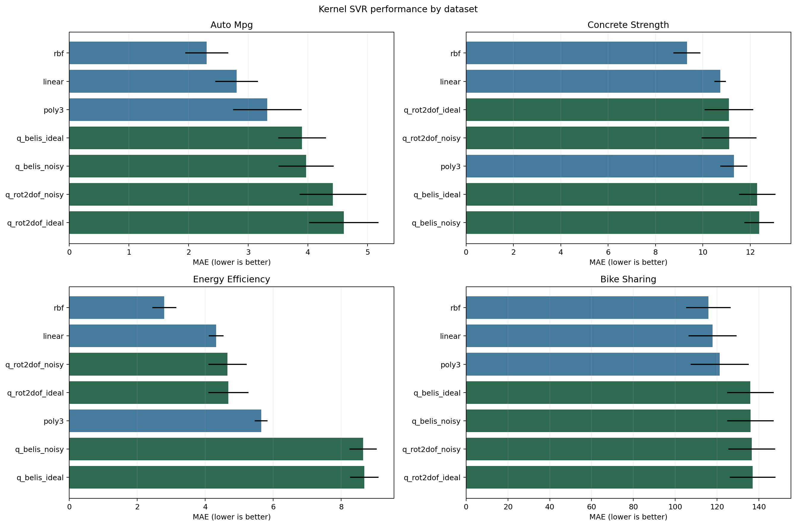
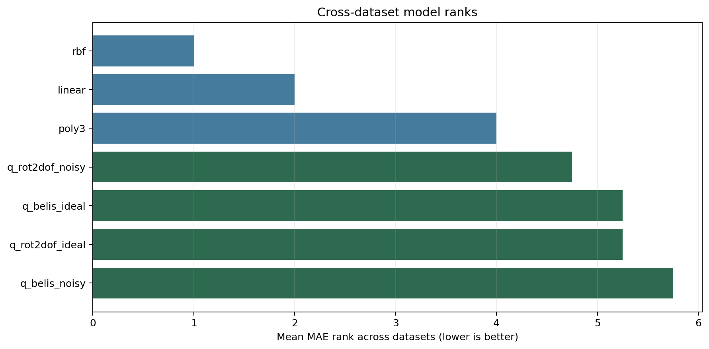
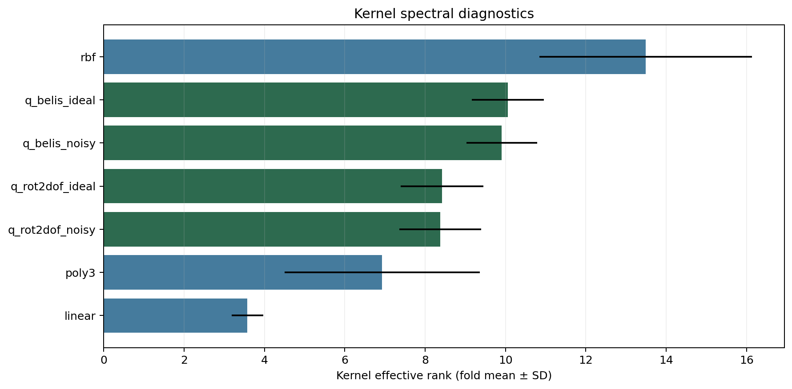
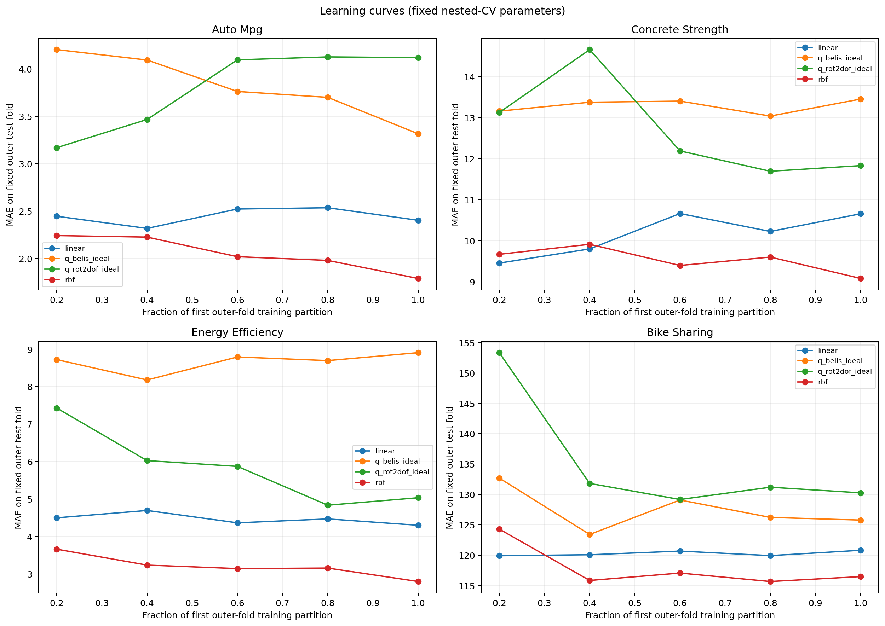

# Multi-dataset QSVM regression benchmark

This study compares linear, RBF, and degree-3 polynomial SVR with ideal and depolarizing-noise Rot2DoF and Belis quantum kernels. Preprocessing and target scaling are fit within each training partition. MAE, RMSE, and R² are reported on the target's original scale.

## Dataset results

Best model per dataset by nested-CV mean MAE:

| Dataset | Best model | MAE ± SD | RMSE ± SD | Mean R² | PSD fraction | Mean kernel seconds |
|---|---|---:|---:|---:|---:|---:|
| auto_mpg | rbf | 2.304 ± 0.360 | 3.176 ± 0.640 | 0.832 | 1.00 | 0.001163 |
| bike_sharing | rbf | 115.894 ± 10.637 | 162.633 ± 14.368 | 0.188 | 1.00 | 0.002091 |
| concrete_strength | rbf | 9.329 ± 0.572 | 11.885 ± 0.643 | 0.476 | 1.00 | 0.002750 |
| energy_efficiency | rbf | 2.795 ± 0.353 | 3.908 ± 0.476 | 0.843 | 1.00 | 0.002494 |

Best classical versus best quantum model by nested-CV MAE:

| Dataset | Best classical | Classical MAE | Best quantum | Quantum MAE | Quantum minus classical |
|---|---|---:|---|---:|---:|
| auto_mpg | rbf | 2.304 | q_belis_ideal | 3.903 | +1.599 |
| bike_sharing | rbf | 115.894 | q_belis_ideal | 135.955 | +20.061 |
| concrete_strength | rbf | 9.329 | q_rot2dof_ideal | 11.097 | +1.768 |
| energy_efficiency | rbf | 2.795 | q_rot2dof_noisy | 4.657 | +1.862 |

## Paired analysis

The lowest mean within-dataset MAE rank is **rbf** (mean rank 1.00). Mean kernel construction time was 0.0021s for classical kernels and 0.4062s for quantum simulation kernels, averaged across outer folds and configured kernels. The paired Wilcoxon results in `../tables/paired_statistics.csv` compare each quantum model with each classical kernel on matching outer folds. Holm adjustment is applied across all 48 comparisons; no comparison is significant after adjustment (minimum adjusted p=1.0000; minimum raw p=0.0625). This run uses 5 outer folds per dataset, so interpret the effect sizes and tests cautiously.
The winner and best-classical-versus-best-quantum rows are post-hoc descriptive summaries selected from outer-fold means; they are not unbiased estimates for a model chosen in advance. The paired tests retain fixed model pairings and are reported separately.

## Figures

### MAE comparison

### Cross-dataset ranks

### Kernel spectral diagnostics

### Learning curves

## Data files

- `../tables/fold_results.csv` and `../tables/aggregate_results.csv`: combined fold-level and summarized results, including effective rank, PSD status, and runtime.
- `../datasets/<name>_fold_results.csv`: per-dataset fold results.
- `../metadata/run_metadata.json`: dataset provenance, sampled row indices, configuration, environment, and seeds.

## Data and method references

The evaluation design is adapted from [Kakavand, Strohmeyer, and Schlotter (2026)](https://arxiv.org/abs/2604.18837). Dataset sources: [Auto MPG](https://doi.org/10.24432/C5859H), [Concrete Compressive Strength](https://doi.org/10.24432/C5PK67), [Energy Efficiency](https://doi.org/10.24432/C51307), and [Bike Sharing](https://doi.org/10.24432/C5W894).

The Auto MPG latest-model-year holdout is reported separately from nested-CV comparisons. Learning curves are descriptive fixed-parameter diagnostics, not independent holdout estimates. No hardware results are included.
